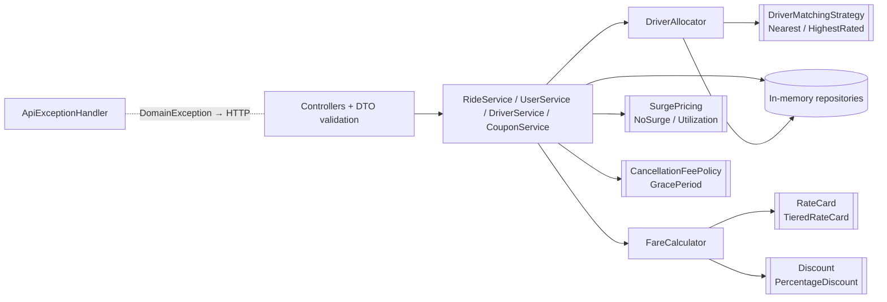

# Ride Hailing Service

In-memory backend for a ride hailing platform: register riders and drivers, track cab locations,
book the best available cab within a radius (with a free Hatchback → Sedan upgrade), end rides with
tiered pricing and coupons, and view ride history. Bonus scope is also implemented: surge pricing,
switchable driver matching, cancellation fees and race-free booking.

**Stack:** Java 25 · Spring Boot 4.1 · springdoc-openapi (Swagger UI) · JUnit 5 / AssertJ / MockMvc · Maven wrapper

## Running it

Prerequisite: JDK 25. Maven is provided by the wrapper.

```bash
./mvnw spring-boot:run          # http://localhost:8080
./mvnw test                     # all tests
./scripts/demo.sh               # walks through every demo edge case (needs curl + jq, server running)
./scripts/api-check.sh          # asserts success + failure responses for every endpoint (72 checks)
```

Swagger UI: <http://localhost:8080/swagger-ui.html>. OpenAPI JSON: `/v3/api-docs`.

### With Docker

Only Docker is needed; the jar is built inside the image.

```bash
docker build -t ride-hailing-service .
docker run --rm -p 8080:8080 ride-hailing-service
```

The image is built in two stages. The first compiles with the project's `./mvnw`; the second is a
JRE-only runtime that runs as a non-root user. Dependencies are cached in their own Docker layer,
so a code change only rebuilds a small layer. The heap is sized from the container's memory limit
(`-XX:MaxRAMPercentage=75`), and `docker stop` shuts the app down gracefully. Tests are not run
during `docker build`; run `./mvnw test` (or CI) for that.

## API

| Method | Path | Purpose | Notable errors |
|---|---|---|---|
| POST | `/users` | Register a rider | 409 `DUPLICATE_USER` (phone) |
| POST | `/drivers` | Register a driver + cab | 409 `DUPLICATE_CAB` (plate) |
| PUT | `/drivers/{id}/location` | Update the cab's location | 404 |
| POST | `/rides` | Book and start a ride | 404 `USER_NOT_FOUND`, 409 `NO_DRIVER_AVAILABLE`, 409 `USER_HAS_ONGOING_RIDE`, 422 `INVALID_COUPON` |
| POST | `/rides/{id}/end` | End the ride, get the fare breakdown | 404, 409 `RIDE_NOT_ONGOING` |
| POST | `/rides/{id}/cancel` | Cancel, get the fee | 404, 409 `RIDE_NOT_ONGOING` |
| GET | `/rides/{id}` | Get a ride | 404 |
| GET | `/users/{id}/rides`, `/drivers/{id}/rides` | History: `ongoing`, `completed`, `cancelled` | 404 |
| POST / DELETE | `/coupons`, `/coupons/{code}` | Add / delete a percentage coupon | 409 duplicate, 404 |

Every error has the shape `{"error": {"code": "...", "message": "...", "details": [...]}}`.
Validation failures return `400 VALIDATION_FAILED` with one detail per field.

```bash
curl -X POST localhost:8080/rides -H 'Content-Type: application/json' \
  -d '{"userId": "user-1", "pickup": {"x": 0, "y": 0}, "carType": "HATCHBACK", "couponCode": "SAVE10"}'
```

## Assumptions

1. **Tiers are marginal slabs**, like tax brackets: km 0–2 cost ₹10/km, km 2–5 cost ₹8/km, and every km after 5 costs ₹5/km. A 7 km hatchback ride is 20 + 24 + 10 = ₹54. The other reading ("the whole ride at its bracket's rate") makes a 7 km ride (₹35) cheaper than a 5 km ride (₹40), so I rejected it.
2. **Minimum fare is a floor** applied to the tiered fare. The order is: rate card → minimum → surge → coupon → never below ₹0. A coupon can take a fare below the minimum fare (the platform pays for the promotion).
3. **Rate cards:** Hatchback uses the example rates (₹50 minimum; ₹10 / ₹8 / ₹5 per km). Sedan uses my own placeholder rates: ₹80 minimum; ₹15 / ₹12 / ₹8 per km. Both are in `application.yml`.
4. **Free upgrade:** if no Hatchback is *available* within the radius (none nearby, or all busy), a Sedan is assigned and the ride is **billed at the Hatchback rate**. The ride records `requestedCarType`, `assignedCarType` and `upgraded`. Sedans are never downgraded.
5. **Booking starts the ride.** There's no separate "driver accepts" or "driver arrives" step. States are `ONGOING → COMPLETED | CANCELLED`.
6. **Locations are (x, y) points on a city grid, in km**, and distance is a straight line. The drop-off is wherever the cab is when the ride ends, so the driver updates their location during or at the end of the ride. Search radius: 5 km, inclusive.
7. **Coupons** are a percentage off with an optional cap. Codes are case-insensitive. A coupon is valid if it exists, i.e. hasn't been deleted. It's applied at booking, and the discount is *captured* then, so deleting the coupon later doesn't change a booked ride. An invalid code **rejects the booking** (422) rather than silently charging full price. There's no per-user usage limit or expiry.
8. A rider has at most one ongoing ride, and a driver serves one ride at a time.
   Riders are unique by phone number. Drivers are unique by cab plate (case-insensitive), not by phone, because a fleet operator may register several cabs under one contact number. Real driver identity would come from licence / KYC checks, which are out of scope.
9. **Driver rating** is an optional seed value at registration (default 5.0), used only by the highest-rated matching strategy. Normally it would come from rider feedback, which is out of scope.
10. **No authentication or authorization.** Any caller can act for any user or driver. IDs are sequential (`user-1`, `ride-1`) to keep demos readable.

## Design



| Package | Responsibility |
|---|---|
| `api` | HTTP only: validate request objects, call one service method, map the response. `ApiExceptionHandler` is the **only** place business error codes become HTTP statuses. |
| `service` | Coordinates each use case. No pricing rules or HTTP code here. |
| `domain` | Entities and invariants: `Ride` state changes, `Driver.tryAssign()`, `CarType.freeUpgrade()`. |
| `pricing` | Plain Java, no Spring: rate cards, discounts, surge, cancellation fees, `FareCalculator`. |
| `matching` | `DriverAllocator` (search → rank → atomic claim → upgrade fallback) and the ranking strategies. |
| `repository` | `ConcurrentHashMap` storage with atomic uniqueness checks. |
| `config` | Typed `application.yml` binding; picks which strategies to wire. |

### Key decisions and trade-offs

| Decision | Why | Alternative I rejected |
|---|---|---|
| **One explicit `FareCalculator` pipeline** | The step order (minimum → surge → coupon) is a business rule, so it should be readable in one method. Each step rounds to paise, and the distance is rounded to 10 m first, so the receipt can be recomputed exactly from its own numbers. | A decorator chain of pricing strategies hides the order, and it's easy to wrap them in the wrong sequence. |
| **Strategy interfaces only where the brief asks for variation** (`RateCard`, `Discount`, `SurgePricing`, `DriverMatchingStrategy`, `CancellationFeePolicy`) | These are the extension points the assignment evaluates. | Interfaces for repositories and services. With a single implementation each, they're speculative abstraction. |
| **Atomic claim (compare-and-set) on `Driver.status`** | Non-blocking, and threads only contend on the same driver. A booking that loses the race falls through to the next-ranked driver. It maps directly to the database version `UPDATE … WHERE status='AVAILABLE'`. | A global `synchronized` makes every booking in the system wait in one queue. A lock per driver is more code with no benefit in memory. |
| **The user is also reserved atomically** (`User.tryStartRide`), and the reservation is rolled back if no driver is claimed | Two simultaneous requests from the same rider can't create two rides. | Checking "has an ongoing ride?" and then booking leaves a race window between the two steps. |
| **Price inputs captured at booking** (billed type, surge, coupon discount) | The rider is charged the terms they were quoted. Deleting a coupon or a change in surge doesn't change a booked ride. | Looking them up when the ride ends gives surprising prices and makes `end` fail if the coupon was deleted. |
| **Rate cards, surge tiers and fees in `application.yml`** | A new tier or price change needs no code change. Constructors check the rules (slabs ascending, last slab open-ended, a rate card for every car type), so bad config **fails at startup**. | Hard-coded Java constants need a recompile for every price change. |
| **Utilization-based surge** (share of nearby cabs that are busy → stepped multiplier) | Uses no extra state and is deterministic to test. | A sliding window of recent booking requests is a truer measure of demand, but needs time-windowed storage and cleanup of old entries. |
| **409 for `NO_DRIVER_AVAILABLE`** | The request is valid but conflicts with the current state (no free cab). | 503 suggests a server fault and would trigger alerts and blind retries. |
| **Service tests use the real objects, wired by hand, with no mocks** | They test real behavior and run in milliseconds. Spring is loaded only for the HTTP contract tests. | Mock-heavy tests that only check which methods were called. |

### Error handling and logging

- **One error path.** Services throw `DomainException` with an `ErrorCode`. `ApiExceptionHandler` is the only place that maps codes to HTTP statuses, and it also wraps validation, malformed JSON and Spring MVC errors (404/405/415) in the same JSON shape. Unexpected exceptions return a 500 with no internal details; the message quotes the request id instead.
- **Request id on every log line.** `RequestLoggingFilter` reuses a caller's `X-Request-Id` only if it is short and alphanumeric, otherwise it generates one. The id is returned in the response header and printed on every log line, so one request can be traced end to end. Each request also gets one access-log line (method, path, status, time taken).
- **Each event logged once.** Services log successful state changes at INFO: registered, booked (with upgrade, surge and coupon), completed (with the fare breakdown), cancelled (with the fee), coupon added or deleted. The exception handler logs every rejection once at INFO with its code. Only unexpected failures are logged at ERROR, with the stack trace.
- **DEBUG detail.** Candidate counts, drivers lost to a concurrent booking, and cab location updates. Enable with `--logging.level.com.ridehailing=DEBUG`.
- **Safe logs.** Phone numbers are never logged (a test checks this). Line breaks in user-supplied path values are replaced before logging, so callers can't forge log lines.
- **Startup.** The effective rate cards, matching strategy, surge tiers and cancellation policy are logged when the app starts.

### Concurrency

`BookingConcurrencyTest` releases 32 riders simultaneously against 2 drivers, repeated 20 times. The test asserts that exactly 2 bookings succeed, the two drivers are different, and everyone else gets `NO_DRIVER_AVAILABLE`. To check the test can actually catch a race, I temporarily replaced the atomic claim with a check-then-set: 17 of the 20 repetitions failed.

## Testing

96 tests, all passing (`./mvnw test`).

| Suite | Covers |
|---|---|
| `TieredRateCardTest` | Every tier boundary (0, 1, 2, 2.5, 5, 6, 10 km), minimum-fare floor, price never decreases with distance, invalid slab config rejected |
| `FareCalculatorTest` | Different rates and minimums per car type, coupon %, coupon cap, coupon applied after the minimum fare, total never negative, surge before coupon, rounding consistency |
| `RideServiceTest` | Radius boundary, no driver nearby (and the user is released afterwards), busy drivers skipped, one ongoing ride per user, **free upgrade billed at the Hatchback rate**, requested type preferred over a closer Sedan, no downgrade, ending a ride twice, valid / invalid / deleted coupon, coupon deleted after booking, cancellation grace boundary, history, surge from booking to fare |
| `BookingConcurrencyTest` | Two bookings can never get the same driver |
| `UtilizationSurgePricingTest`, `DriverMatchingStrategyTest` | Strategy behavior on its own |
| `LoggingAndCorrelationTest` | Request id reused or regenerated, state changes and rejections logged once, no phone numbers in logs, line breaks neutralised, 500 response hides internals |
| `RideHailingApiTest` | HTTP lifecycle, status codes, error shape, validation details, unknown enum, infinite coordinates, OpenAPI document |

**Black-box endpoint check.** `scripts/api-check.sh` sends real HTTP requests to a running server and
checks the status code and key fields for every endpoint. It covers each requirement's success and
failure cases (72 checks), including 20 parallel bookings for one driver. Pass a second URL to also
check the post-grace cancellation fee and the highest-rated strategy, against a server started with
overridden config:

```bash
docker run -d -p 8080:8080 ride-hailing-service
docker run -d -p 8082:8080 ride-hailing-service --pricing.cancellation.grace-period=0s --ride.matching-strategy=highest-rated
./scripts/api-check.sh http://localhost:8080 http://localhost:8082
```

## Making the likely live-extension changes

| Change | Where |
|---|---|
| **New car type (SUV)** | Add a constant to `CarType`. The exhaustive `switch` in `freeUpgrade()` won't compile until you decide its upgrade path. Then add a rate card and a cancellation fee in `application.yml`. If either is missing, the app refuses to start. Also update the fixture in `PricingFixtures`. |
| **New pricing tier** | Add one slab under `pricing.rate-cards.<TYPE>.slabs` in `application.yml`. Add a boundary row to `TieredRateCardTest`. |
| **Flat-discount coupon** | Add a `FlatDiscount implements Discount` record (`amountOff` returns the flat amount; `FareCalculator` already stops a discount from exceeding the fare). Add a `type` field to `CreateCouponRequest`, and make `CouponResponse` handle both kinds (it currently assumes percentage). |
| **Another matching strategy** | Implement `DriverMatchingStrategy`, add an enum value to `RideProperties.MatchingStrategyType`, and add it to the `switch` in `AppConfig`. Booking code doesn't change. |

## What I'd do with more time

- **Persistence:** Postgres with an optimistic-locking `version` column (or the conditional `UPDATE` above) on driver status, unique constraints on phone and plate, indexes on `ride(user_id)` and `ride(driver_id)`, and Flyway migrations.
- **Finding nearby drivers:** replace the linear scan with a spatial index (geohash cells, Redis GEO or PostGIS), and switch to real latitude/longitude with haversine distance (`Location.distanceTo` is the only place to change).
- **Distance from the GPS trail:** sum the location updates during the ride instead of measuring pickup → drop-off in a straight line.
- **Auth:** JWT with rider and driver roles, and checks that a caller can only act on their own records (only the assigned driver ends a ride, riders see only their own history).
- **Idempotency keys** on `POST /rides` so a client retry can't create a second booking.
- **Coupons:** expiry dates, usage limits per user and overall, and minimum-fare conditions.
- **Ride lifecycle:** driver accept / arrive steps, drivers going online and offline, ratings from rider feedback, pagination on history.
- **Observability:** structured logs for each booking event, and metrics for match rate and time to match.

## How I used AI

I built this with Claude Code as a pair programmer. My rule for myself: the AI can write code, but
every design decision is mine, and nothing counts as done until it is tested and I can explain it.

### 1. Setting the ground rules: the system prompt

Before sharing the assignment, I gave the AI a system prompt that set how it should work:

- **Role:** a Senior/Staff backend engineer and a strict code reviewer, responsible for everything
  from understanding the problem to delivering it.
- **Priorities, in order:** correctness, then data integrity and security, then clear design,
  tests, reliability, performance, extensibility and documentation.
- **Hard rules:** don't invent requirements; never claim something works without running it; never
  make up test results; prefer the simplest design that fully meets the brief; no "architecture
  decoration" such as microservices or CQRS; SOLID applied pragmatically, not dogmatically.
- **A fixed workflow:** understand → propose → implement with tests → validate → prepare for the
  review. In particular, it had to show me a requirement-to-test checklist, the architecture, the
  API contracts, the data model and the milestones before writing any real code.

I added one more rule during the session: **wherever there is a real trade-off in design or tech
stack, present the options and wait for my decision before implementing.**

### 2. Requirements

I gave the AI the assignment PDF and asked for every requirement to be extracted and mapped to the
place it would be implemented and the test that would prove it.

- **Functional:** the 10 mandatory requirements (registration, cab location, booking within a
  radius, ending a ride with its cost, tiered pricing with a minimum fare, history for users and
  drivers, Sedan/Hatchback rates with the free upgrade, coupons) and the 4 bonus items (surge,
  switchable matching, cancellation fee, concurrency safety).
- **Non-functional, which I made explicit:** correct money handling (`BigDecimal`, receipts that
  add up), no double-booking under concurrent requests, uniqueness checks that are safe under
  concurrency, validated input with one consistent error format, no internals leaked in errors,
  extension points where the brief says things will change, and a project a reviewer can run and
  test with one command.
- **Assumptions:** anything the brief left open was written down (see *Assumptions* above) rather
  than silently decided in code.

### 3. Trade-offs I decided

For each of these, the AI laid out the options with pros and cons and a recommendation, and I chose:

| Decision | What I chose | Why, briefly |
|---|---|---|
| Interface | REST API with Swagger | Easy to demo edge cases; self-documenting |
| Spring Boot version | 4.1 rather than 3.5 | Current release line with proper Java 25 support |
| How tiers apply | Each km at its own slab's rate | The other reading makes 7 km cheaper than 5 km |
| Distance model | (x, y) grid in km | Exact, predictable fares for tests and demo; haversine is a one-method change |
| Preventing double-booking | Atomic claim on the driver | Non-blocking; maps to optimistic locking in a database |
| Surge signal | Share of nearby cabs that are busy | No extra state; a request-rate window was too much for a bonus item |
| Cancellation policy | Free grace period, then a flat fee per car type | Simple to explain and test |

The AI also proposed defaults that I reviewed and accepted: one explicit fare pipeline instead of a
decorator chain, no repository interfaces with a single implementation, a linear scan for nearby
drivers (a spatial index noted as future work), rejecting an invalid coupon with 422 rather than
silently charging full price, and pricing settings in config that are checked at startup.

### 4. Building it

The core was built in milestones, one commit each, with tests written alongside the code:
project setup → pricing engine → booking, matching, upgrade and coupons → REST layer → bonus items
→ review fixes → README. Fares in tests were calculated by hand rather than copied from program
output.

### 5. Improvements after the core was done

Once the mandatory scope was solid, I asked for further work on a separate `improvisation` branch:

- **Docker:** a two-stage build that only needs Docker, runs as a non-root user, sizes its memory
  from the container limit and shuts down cleanly. I verified it by running the full demo against
  the container.
- **Endpoint checks:** `scripts/api-check.sh`, 72 checks of the success and failure responses of
  every endpoint against the requirements, including 20 simultaneous bookings for one driver.
- **Logging and error handling:** a request id on every log line (also returned in the
  `X-Request-Id` header), each state change and each rejection logged exactly once, phone numbers
  never logged, protection against log injection, and 500 responses that quote the request id
  instead of exposing internals.
- **Cleanup from my own gap review:** test-only helper methods moved out of the main code, and the
  rule "drivers are unique by plate, riders by phone" documented as a deliberate decision.

### 6. What I rejected or rewrote, and why

- **Rejected designs:** a decorator chain for pricing (hides the order of steps); interfaces with a
  single implementation (speculative abstraction); charging the whole ride at one tier's rate
  (longer rides could cost less); a sliding-window surge (too much machinery for a bonus item).
- **Bugs caught in review and fixed:**
  - The receipt showed a rounded distance but charged the unrounded one. It now prices the
    distance it shows.
  - A failed booking released the rider's reservation from inside an `orElseThrow` callback, and
    only on one failure path. It's now an explicit try/catch.
  - Plate numbers were case-sensitive for uniqueness.
- **Tests that were themselves wrong:**
  - A test helper shared one counter for two purposes, which would eventually have pushed
    coordinates out of range.
  - The first endpoint-check run reported 45 failures. All were bugs in the script (phone numbers
    one digit too short, and a counter that never advanced), not in the app.
  - The first log-injection test passed for the wrong reason, because the test tool encoded the
    `%`, so no real line break was ever sent.

### 7. How I convinced myself it is correct

- **Fares:** every expected fare in the tests was worked out by hand.
- **Mutation testing:** I broke the code on purpose to confirm the tests catch it. With a
  non-atomic driver claim, the concurrency test failed 17 of 20 runs; with the log sanitizer
  removed, the log-injection test failed.
- **Live runs:** the demo script and the endpoint checks were run against the live server and
  against the Docker image.
- **Compiler and imports:** `javac -Xlint:all` reports zero warnings, and there are no unused
  imports.
